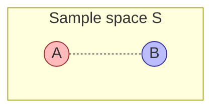

---
tags:
  - simc
---

# Sample Spaces, Events, and Axioms

## What it is

Probability starts with a single, deceptively simple question: ==what could happen?== Before you compute anything, you must enumerate the possibilities. A **sample space** is just that — the set of every possible outcome of a random experiment, written down.

Roll a fair six-sided die. The sample space is $\{1, 2, 3, 4, 5, 6\}$ — six things, one of which definitely happens. Flip a coin: $\{H, T\}$. Flip two coins: $\{HH, HT, TH, TT\}$. That's it. No math yet, just bookkeeping.

An **event** is then a *question you can ask* about the outcome — "did the die show an even number?" — formalised as the subset of the sample space that answers "yes": $\{2, 4, 6\}$. Probability, finally, is a rule for assigning a number between 0 and 1 to each event, telling you how strongly to believe it will happen.

The three together — sample space, events, probability function — are the foundation everything else in this course is built on. Get them wrong and every downstream calculation is silently wrong too.

## Formal definitions

### Sample space

> [!info] Sample space
> The **sample space** $S$ (sometimes $\Omega$) of a random experiment is the set of all possible outcomes. Each outcome is a single element of $S$; exactly one outcome occurs per trial.

Examples:

- One die roll: $S = \{1, 2, 3, 4, 5, 6\}$. Finite, 6 elements.
- One coin flip: $S = \{H, T\}$.
- Two dice (ordered): $S = \{(i, j) : i, j \in \{1, \ldots, 6\}\}$, so $|S| = 36$.
- Number of jeans a random student owns: $S = \{0, 1, 2, 3, \ldots\}$. Countably infinite.
- Time until a radioactive atom decays: $S = [0, \infty)$. Uncountably infinite (continuous).

> [!tip] Choose $S$ to match the question
> The same physical experiment can have different sample spaces depending on what you care about. Two dice could be $S = \{(i,j)\}$ (36 outcomes) or $S = \{2, 3, \ldots, 12\}$ (11 sums) — but those 11 sums are ==not equally likely==. Picking the wrong granularity is the #1 source of "I got the answer wrong and don't know why" in early probability.

### Event

> [!info] Event
> An **event** $E$ is any subset of the sample space: $E \subseteq S$. Events are usually written with capital letters $A, B, C, \ldots$.

A single outcome (e.g. rolling a 3) is a one-element event $\{3\}$. A "compound" event groups several outcomes (e.g. "rolling even") $= \{2, 4, 6\}$.

Because events are sets, all the set algebra works:

| Operation | Notation | Meaning |
|-----------|----------|---------|
| Union | $A \cup B$ | $A$ **or** $B$ (or both) |
| Intersection | $A \cap B$ | $A$ **and** $B$ |
| Complement | $A^c$ (also $A'$, $\bar{A}$) | **not** $A$ |
| Empty event | $\emptyset$ | impossible — no outcomes |
| Mutually exclusive | $A \cap B = \emptyset$ | $A$ and $B$ cannot both happen |
| Exhaustive | $A_1 \cup A_2 \cup \cdots = S$ | at least one of them must happen |

The overlap is $A \cap B$; everything inside either circle is $A \cup B$; everything in $S$ outside the circles is $(A \cup B)^c$.

### Probability function

> [!info] Probability function
> A **probability function** $P$ is a rule that takes an event and returns a real number in $[0, 1]$, written $P(E)$, satisfying the three axioms below. ==$P$ is a function on subsets of $S$, not on outcomes alone.==

Three practical ways to *assign* a $P$:

1. **Classical** — when outcomes are equally likely: $P(E) = \dfrac{|E|}{|S|}$. (Fair dice, fair coins, well-shuffled decks.)
2. **Relative frequency** — repeat the experiment $n$ times, count how often $E$ occurs ($N(E)$ times): $P(E) \approx \dfrac{N(E)}{n}$. Converges as $n \to \infty$ (law of large numbers).
3. **Subjective** — a calibrated belief ("70% chance of rain"). Useful when the experiment can't be repeated.

All three must satisfy the same axioms below to count as probabilities.

