---
tags:
  - simc
---

# Singular Value Decomposition (SVD)

> [!abstract] In one line
> Every matrix — square or not — can be torn into three simple pieces: a rotation, a set of stretch factors, and another rotation. SVD finds those pieces, and the stretch factors rank the directions that matter most.

## The idea

[[eigenvectors-and-eigenvalues|Eigen-decomposition]] only works on square matrices. But your data is almost never square — an IR dataset is $n$ samples $\times$ $p$ wavenumbers, a tall skinny rectangle. SVD is the version of eigen-decomposition that works on **any** matrix, of any shape.

The geometric story: a matrix is a machine that takes a vector, transforms it, and outputs a new vector. SVD says that **every** such machine, no matter how complicated it looks, is secretly just three operations done in a row:

1. **Rotate** (line the input up with some natural axes) — this is $V^\top$
2. **Stretch** (scale each axis by a fixed amount, never rotating) — this is $\Sigma$
3. **Rotate again** (reorient into the output space) — this is $U$

That's the whole content of SVD: *rotate, stretch, rotate.* The stretch factors — the **singular values** — tell you how strongly the matrix acts along each direction. Big singular value = a direction the matrix really cares about. Tiny singular value = a direction it almost flattens to nothing (= throwaway noise).

```mermaid
graph LR
    x["input vector"] -->|"V&#8868;  rotate"| a["aligned"]
    a -->|"&Sigma;  stretch"| b["scaled"]
    b -->|"U  rotate"| y["output vector"]
```



## The math

For **any** real matrix $A$ of shape $m \times n$:

$$A = U\,\Sigma\,V^\top$$

| Piece | Shape | What it is |
|---|---|---|
| $U$ | $m \times m$ | **Left singular vectors** — orthonormal columns $\mathbf{u}_1,\dots,\mathbf{u}_m$. The output-space axes. |
| $\Sigma$ | $m \times n$ | Diagonal, holding the **singular values** $\sigma_1 \ge \sigma_2 \ge \dots \ge 0$ down the diagonal, zeros elsewhere. |
| $V^\top$ | $n \times n$ | Transpose of $V$, whose columns $\mathbf{v}_1,\dots,\mathbf{v}_n$ are the **right singular vectors** — the input-space axes. |

- $U$ and $V$ are **orthogonal**: their columns are unit length and mutually perpendicular ($U^\top U = I$, $V^\top V = I$). Pure rotations/reflections, no stretching.
- $\Sigma$ does all the stretching. Singular values are always **non-negative** and sorted largest-first.
- The number of non-zero singular values is the **rank** $r$ of $A$ — the true number of independent directions in the data.

### Connection to eigenvectors

SVD isn't a separate idea from eigen-decomposition — it *is* eigen-decomposition, applied to $A^\top A$ and $AA^\top$:

$$A^\top A = V\,\Sigma^\top\Sigma\,V^\top \qquad\Longrightarrow\qquad \text{columns of } V \text{ are eigenvectors of } A^\top A$$
$$AA^\top = U\,\Sigma\Sigma^\top\,U^\top \qquad\Longrightarrow\qquad \text{columns of } U \text{ are eigenvectors of } AA^\top$$

And the singular values are the **square roots of those eigenvalues**:

$$\sigma_i = \sqrt{\lambda_i\big(A^\top A\big)}$$

> [!note] Key property — this is the whole reason SVD matters for PCA
> Squaring a singular value gives an eigenvalue. So if you SVD the [[design-matrix]] directly, you get the eigenvectors of the [[covariance-matrix]] *for free*, without ever building the covariance matrix. That step is the slow, error-amplifying one — SVD skips it.

### Three flavours (know which one you're computing)

| Flavour | $U$ size | Keeps | Use when |
|---|---|---|---|
| **Full** | $m \times m$ | everything | textbook / rarely needed |
| **Reduced (thin)** | $m \times r$ | only the $r$ non-zero triplets | the practical default |
| **Truncated** | $m \times k$ | only the **top $k$** triplets | compression / [[dimensionality-reduction]] |

### Low-rank approximation (the compression theorem)

Write $A$ as a sum of rank-1 layers, one per singular value:

$$A = \sum_{i=1}^{r} \sigma_i\,\mathbf{u}_i\mathbf{v}_i^\top$$

Each layer is "direction $\times$ strength." Because the $\sigma_i$ are sorted, the first few layers carry almost all of the matrix. Keep only the top $k$:

$$A_k = \sum_{i=1}^{k} \sigma_i\,\mathbf{u}_i\mathbf{v}_i^\top$$

> [!tip] Eckart–Young theorem
> $A_k$ is the **provably best** rank-$k$ approximation of $A$ — no other rank-$k$ matrix is closer (in Frobenius or spectral norm, see [[vector-norm-and-distance]]). The error you accept by truncating is exactly the size of the singular values you dropped: $\|A - A_k\|_F^2 = \sigma_{k+1}^2 + \dots + \sigma_r^2$. This is why SVD is *the* tool for lossy compression — of images, of spectra, of anything.

> [!warning] Common confusion
> Singular values $\sigma$ are **not** eigenvalues $\lambda$. They relate by $\sigma_i = \sqrt{\lambda_i}$ where $\lambda$ are the eigenvalues of $A^\top A$. Singular values are always $\ge 0$; eigenvalues of a general matrix can be negative or complex. They only coincide (up to sign) for symmetric positive-semidefinite matrices like a covariance matrix.

> [!example] Tiny shape check
> A $50 \times 1000$ spectral matrix has rank at most 50 (you can't have more independent directions than samples). So its reduced SVD gives at most **50 non-zero singular values**, even though there are 1000 wavenumbers. Almost all the "1000-dimensionality" is illusory — exactly the [[manifold-hypothesis|low-dimensional structure]] PCA exploits.

## In code (NumPy)

```python
import numpy as np

# X_centered is the n x p centered design matrix (mean already subtracted)
# full_matrices=False gives the reduced/thin SVD — what you almost always want
U, s, Vt = np.linalg.svd(X_centered, full_matrices=False)

# s   -> 1D array of singular values, already sorted largest-first
# Vt  -> rows are the right singular vectors (principal component directions)
# U   -> columns are the left singular vectors

# --- PCA straight from the SVD, no covariance matrix needed ---
n = X_centered.shape[0]
eigenvalues = s**2 / (n - 1)          # variance captured by each PC
loadings    = Vt.T                    # columns = principal components (the v_k)
scores      = U * s                   # each sample's coordinates in PC space (= X_centered @ Vt.T)

explained_variance_ratio = eigenvalues / eigenvalues.sum()
```

> [!note] Why `numpy.linalg.svd` returns `Vt`, not `V`
> NumPy hands back $V^\top$ already transposed (note the name `Vt`). To recover the principal-component directions as columns, transpose it back: `Vt.T`. Forgetting this transpose is the #1 SVD-in-NumPy bug.

## SVD route vs. eigen route to PCA

Two ways to reach the same principal components:

| | Eigen route | SVD route |
|---|---|---|
| Build covariance matrix? | Yes — $C = \tfrac{1}{n-1}\tilde X^\top \tilde X$ | No — SVD $\tilde X$ directly |
| Engine | [[power-method]] / `np.linalg.eigh` on $C$ | `np.linalg.svd` on $\tilde X$ |
| PCs come from | eigenvectors of $C$ | right singular vectors $V$ |
| Variances come from | eigenvalues $\lambda_k$ | $\sigma_k^2/(n-1)$ |
| Numerical accuracy | worse (squaring $\tilde X$ squares the condition number) | better — the standard choice |

Both give identical answers in exact arithmetic. SVD wins in practice because forming $\tilde X^\top \tilde X$ throws away precision; this is why `sklearn.decomposition.PCA` runs an SVD internally, not an eigendecomposition.

## Why this matters for PCA on IR spectra

PCA *is* an SVD of the centered spectral [[design-matrix]]. The right singular vectors $\mathbf{v}_k$ are the principal components (the loadings — which wavenumbers define each chemical factor); the singular values squared give the variance each component explains, feeding the [[eigenspectrum]] scree plot; and $U\Sigma$ gives the scores you actually run statistics on. Because Beer–Lambert makes IR absorbance linear in concentration, the chemistry lives in a handful of singular values — truncating the rest is a principled, Eckart–Young-optimal denoising of your spectra. When SIMC judges ask "how did you compute the PCA," the honest and correct answer is: *a truncated SVD of the centered data matrix.*

## Builds on
- [[matrix]]
- [[eigenvectors-and-eigenvalues]]
- [[eigenvectors-of-the-covariance-matrix]]
- [[design-matrix]]
- [[covariance-matrix]]
- [[vector-norm-and-distance]]

## Leads to
- [[principal-component-analysis]]
- [[dimensionality-reduction]]
- [[eigenspectrum]]
